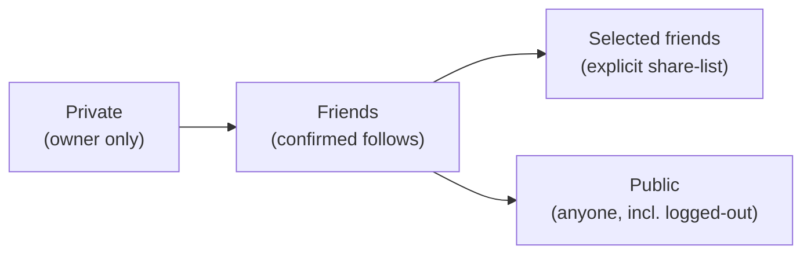

# PhotoLib — Proposed Target Architecture

> **Status: FUTURE / PROPOSED.** Nothing in this document is implemented.
> It describes a target direction for evolving PhotoLib from today's
> single-backend offline-first web app (see `PROJECT-ANALYSIS.md` for what
> actually exists) into a hybrid **Local-first Desktop + optional Cloud/
> Social platform**. See `MIGRATION-PLAN.md` for the phased path from the
> current codebase to this target, including what changes, in what order,
> and at what risk.

---

## 0. Why this direction

Today, PhotoLib is one thing: an offline-tolerant web client against one
ASP.NET Core backend that a small group of people share over a private
network. "Offline" is a temporary, recoverable degradation of that one
backend being unreachable — not a genuinely independent mode of operation.
There is no concept of "my own photos, fully usable, with no account and
no server anywhere," and no concept of "content that outlives my own
machine being switched off."

The proposed direction splits these concerns explicitly:

- **A local-first desktop app** that works completely on its own, forever,
  with no account and no network — your own machine is the only source of
  truth for your own library.
- **An optional cloud account** you can connect that local library to,
  which stores **only what you explicitly publish or sync** — not a
  silent mirror of everything.
- **A social layer** (friends, following, public/restricted feeds) that
  depends on the cloud account existing, and which must keep working even
  when the original owner's desktop is off.
- **A web interface** to the cloud account, independent of any desktop app
  being installed or running anywhere.

These are four different trust/availability domains, and the biggest
architectural risk in this migration is treating them as one thing (as
today's single-backend model implicitly does) instead of four things with
clear boundaries between them.

---

## 1. System overview

```mermaid
graph TB
    subgraph "User's Machine(s)"
        D1["PhotoLib Desktop\n(local SQLite + local files)"]
        D2["PhotoLib Desktop\n(a second machine, same account)"]
    end

    subgraph "PhotoLib Cloud (optional)"
        API["Cloud API"]
        CloudDB[("Cloud DB\n(users, follows,\npublished content index)")]
        Blob[("Blob/object storage\n(published originals +\nderivatives)")]
        API --> CloudDB
        API --> Blob
    end

    subgraph "Other People"
        Friend["Friend's PhotoLib\n(Desktop or Web)"]
        Visitor["Anonymous visitor\n(public feed only)"]
    end

    D1 <-->|"explicit publish /\nselective sync"| API
    D2 <-->|"same account,\nown local library"| API
    Web["PhotoLib Web\n(browser)"] --> API
    Friend --> API
    Visitor -->|"public content only"| API

    style D1 fill:#2a3f5f
    style D2 fill:#2a3f5f
    style API fill:#4a3f1f
    style Web fill:#1f4a3f
```

Key properties this diagram is meant to capture:

- `D1` and `D2` each have their **own independent local database and
  files** — they are not thin clients of the cloud. Losing network access,
  or never having a cloud account at all, does not degrade them.
- The cloud (`API` + `CloudDB` + `Blob`) is **not a mirror** of a user's
  local library. It holds an index of accounts/follows/relationships plus
  whatever content (and derivatives) has actually been published or
  explicitly synced.
- `Friend`/`Visitor` reach content exclusively through the cloud — never
  directly through `D1`'s or `D2`'s local storage, which is never
  network-reachable at all.
- `Web` is a first-class client of the same cloud API `Friend` and
  `Visitor` use — not a reduced-functionality fallback.

---

## 2. The three usage environments

### A. PhotoLib Desktop / Local

A standalone application, usable indefinitely with:
- **No authentication required.** Opens straight to a local library.
- **No mandatory internet connection**, ever, for core functionality
  (create galleries, import/organize/tag photos, browse, view).
- **Local SQLite database** — the same EF Core schema concepts used today
  (`Gallery`, `Photo`, `Tag`, `SortOrder`, soft delete) apply locally,
  minus anything inherently server-side (auth tables, rate-limit state).
- **Local photo storage** on the user's own filesystem, with real folder/
  file access (not confined to a browser's sandboxed storage quota the way
  today's web app's IndexedDB caches are).
- **The existing Angular UI reused**, not rebuilt — see §6 for how.
- An **optional** "sign in" affordance that, when used, connects this
  local library to a cloud account for publishing/cross-device sync —
  never required to use the app.

### B. PhotoLib Cloud / Social

An optional service a Desktop (or Web) user can connect to. Authentication
unlocks:
- User profiles, friends/following relationships.
- Public and restricted (friends-only / selected-friends-only) photo feeds
  and collections — the `Visibility` model already sketched in `TODO,md`'s
  Social/Collaboration section, now with an actual data architecture (§4).
- A cross-user Discovery feed — the existing single-user, tag-weighted
  Discovery feed (`DiscoveryFeedService`, live today) is the direct
  precursor; the cloud version extends its candidate pool from "my own
  photos" to "my own photos + my friends' public photos + public
  collections I follow," using the same weighting mechanism.
- Saving (bookmarking) another user's permitted photo into your own feed,
  with ownership/attribution preserved (§4.5).
- **Published content must survive the owner's device being off.** This is
  the load-bearing requirement that makes "cloud" a real second copy, not
  just a routing layer in front of someone's home computer.

### C. PhotoLib Web

A browser-based client of the Cloud API — not a reduced version of
Desktop, not dependent on anyone's desktop app being online. Supports
authentication, public feed/collection/profile browsing, following/
friends management, and viewing content according to the viewer's
permissions. A logged-out visitor can browse public content with no
PhotoLib installation anywhere.

---

## 3. Local and Cloud data architecture

### 3.1 Guiding separation of responsibilities

| | Local (Desktop) | Cloud |
|---|---|---|
| Source of truth for | the user's full personal library | published/synced content only, across all users |
| Exists without the other? | yes, always | no — cloud accounts are meaningless without at least one device that published to them, but once published, content outlives the *specific device* that published it |
| Database | local SQLite, one file per install | a real multi-tenant server database (PostgreSQL — see `MIGRATION-PLAN.md` Phase 5's existing SQLite-scaling note, now a precondition rather than a someday-nicety) |
| Photo files | local filesystem, user-chosen location | object/blob storage (§5), decoupled from any single device |
| Deleting the account | does **not** touch local files | removes the user's cloud-side published content (subject to revocation semantics, §3.6) |
| Disconnecting from cloud | local library keeps working exactly as before | previously-published content's fate is a deliberate choice (§3.6), not an automatic deletion |

### 3.2 Five distinct operations (not one "sync")

Today's outbox/sync model (see `PROJECT-ANALYSIS.md` §8) has exactly one
operation: *reconcile my queued local edits against one backend's current
state*. The proposed model needs five operations, each with different
semantics, different trust boundaries, and different failure modes:

1. **Private synchronization between a user's own devices** — `D1` and
   `D2` in §1's diagram, same account, both private. Conceptually closest
   to today's outbox/sync-coordinator, but now syncing *through* the cloud
   account as a relay/source-of-truth rather than directly against a
   single shared backend instance. Nothing here is visible to anyone else.
2. **Publication of a gallery/collection** — an explicit user action that
   copies (not moves) a gallery's content, plus whatever derivatives are
   needed (§5), into cloud storage, and marks it with a `Visibility`
   level. The local copy is unaffected; the cloud now holds an independent,
   durable copy.
3. **Sharing with selected users** — a visibility/permission grant
   (§4.4/5 below) scoped to specific people rather than "public," layered
   on top of a publication (you can't share what isn't published, at least
   not published-to-the-recipient).
4. **Viewing another user's shared/published content** — a read path
   through the Cloud API, permission-checked per-request, never touching
   the publisher's device.
5. **Saving another user's permitted photo into a personal feed** — a
   *reference*, not a copy of ownership: the saving user gets a pointer
   (and, depending on granted permission, cached derivatives) into their
   own feed, while the original photo's ownership and attribution stay
   with its original uploader (§3.5).

These are deliberately kept as five distinct, independently-reasoned-about
operations rather than one generalized "sync everything" primitive — see
§7 for why conflating them is the single biggest risk this architecture is
designed to avoid.

### 3.3 Stable identity across domains

A photo (or gallery) needs an identity that survives:
- Being created locally, before any cloud account is connected.
- Being published to the cloud later.
- Being synced to a second local device.
- Being saved into another user's feed.

Proposal: every entity keeps the existing `ClientTempId`-style local id at
creation, but gains a **globally-stable cloud id** the moment it's first
published (not at creation) — assigned once, by the cloud, never by a
device. Devices never mint cloud ids themselves (avoids the "two devices
independently publish the same conceptual photo and create two cloud
records" race). A local-only photo that's never published simply has no
cloud id, ever — and that's a valid, permanent, expected state, not a
"not yet synced" pending state the way an unsynced outbox entry is today.

### 3.4 Permissions and revocation

A `Visibility`/permission grant is **not a single boolean**. Proposed
shape, extending `TODO,md`'s existing sketch:

Each level is itself decomposed into the four permission *kinds* from §5.2
(view / view-high-res / download-original / include-in-another-feed) —
"Friends can view, but not download originals or re-share" is a valid,
expected configuration, not an edge case.

**Revocation**: changing a gallery from Public back to Private, or
removing a specific friend's share access, must:
- Immediately stop new requests for that content from succeeding (a
  permission check on every read, not a one-time copy-then-forget).
- **Not** retroactively delete anything another user already explicitly
  *saved* into their own feed (§3.5) — revocation withdraws future access
  to the *source*, it doesn't reach into someone else's library. This
  mirrors how revoking a Google Doc's share link doesn't un-download a PDF
  someone already exported from it. This trade-off should be stated
  explicitly to users at share-time, not left implicit.

### 3.5 Ownership and attribution when content appears elsewhere

When User B saves User A's public photo into their own feed:
- The photo's **ownership never changes** — it is still A's photo, in A's
  account, subject to A's permissions and A's eventual deletion.
- B's feed holds a **reference** (cloud id + cached derivative, per the
  permission level A granted) plus attribution metadata (`savedFrom: A`,
  `savedAt: ...`).
- If A later deletes the photo or revokes B's access, B's reference
  becomes a tombstone (shows "no longer available," doesn't silently keep
  serving a cached copy B has no ongoing right to) **unless** A's original
  grant explicitly included "download original" — in which case B already
  has a legitimate independent copy, and that's a deliberate, granted
  outcome, not a bug.
- Discovery/feed algorithms (extending `DiscoveryFeedService`) must always
  render attribution ("via @username") when showing a saved photo — never
  presenting it as though B took it.

### 3.6 What disconnecting/deleting an account does *not* do

Explicitly, to satisfy the requirement that local data survives cloud
account loss:

- Deleting a cloud account removes that account's ability to authenticate
  and removes its *cloud-side* published content (per the account's own
  deletion-request semantics — immediate vs. grace-period is a product
  decision, not an architectural one) — it does **not** touch any local
  device's SQLite file or local photo folder.
- Disconnecting a local Desktop install from a cloud account (without
  deleting the account) stops future publish/sync actions from that
  device; previously-published content stays live in the cloud exactly as
  before, since the cloud's copy was never a live pointer back to that
  specific device.

---

## 4. Image storage and delivery

### 4.1 Derivative strategy (proposed)

Today's backend produces exactly one derivative: a 300×300-max JPEG
thumbnail (`PhotoImageProcessingService`, confirmed in `PROJECT-ANALYSIS.md`
§7). Proposed tiers, generated **once, at publish time**, not per-request:

| Tier | Approx. size | Format | Purpose |
|---|---|---|---|
| Thumbnail | 300px max edge | WebP (JPEG fallback) | grid/feed tiles — today's existing tier, format upgraded |
| Medium preview | ~1200px max edge | WebP (JPEG fallback) | in-feed/viewer default display, new tier |
| High-resolution | ~2400px max edge or source-capped | WebP/AVIF where supported (JPEG fallback) | "view larger" / zoomed viewing, new tier |
| Original | as uploaded | source format, untouched | download only, gated by permission (§4.2) |

AVIF offered where the requesting client's `Accept` header supports it
(modern Chromium/Firefox/Safari all do today); WebP as the broad-support
default; JPEG as the universal fallback for anything that negotiates
neither — standard content-negotiation via `Accept`, no client-side
format detection needed.

**Responsive delivery**: the cloud API serves `srcset`-friendly URLs per
tier (`/photo/{id}/derivative/{tier}`), so the web/desktop clients request
only the tier that fits their actual display size — not always the
largest. This is a real gap against today's implementation (confirmed in
`PROJECT-ANALYSIS.md` §7 — the current viewer always fetches the full
original for full-screen display) and should be fixed for the cloud path
regardless of the rest of this migration's timeline, since it directly
affects both delivery cost and perceived performance once content is
served to people other than the owner.

### 4.2 Permission model is not one flag

The task's explicit requirement — don't assume these are identical —
maps to four independently-grantable permissions per share:

1. **View** (thumbnail + medium preview) — the baseline for anything
   visible at all.
2. **View high-resolution** — unlocks the high-res tier in the viewer
   (e.g. for friends, not anonymous public visitors).
3. **Download original** — unlocks fetching the untouched source file —
   the only permission that hands over bytes the recipient can do
   anything with outside PhotoLib (print, re-edit, re-upload elsewhere).
4. **Include in another user's feed** — whether a *saved* reference (§3.5)
   is allowed at all, independent of whether the saving user could
   separately download the original.

A public collection meant purely for browsing (view + view-high-res, no
download, no re-save) is a legitimate and probably *common* configuration
— treating all four as one "can see this" boolean would make that
impossible to express.

### 4.3 Storage cost and backup implications

- Publishing multiplies storage: a photo published by its owner now exists
  in (at minimum) the owner's local file + the cloud's original + the
  cloud's 3 derivative tiers. This is an explicit, accepted cost of
  "published content survives the owner's device being off" — there is no
  way to satisfy that requirement without a real independent copy
  somewhere other than the owner's own device. Local-only photos (never
  published) stay exactly as cheap as today — one file, no derivatives
  beyond the local thumbnail.
- The cloud needs its own backup strategy, independent of the existing
  Docker Compose `backup` service (which only makes sense for a
  single-instance, single-database deployment) — see `MIGRATION-PLAN.md`
  Phase 5 for sequencing this against the SQLite→PostgreSQL move it already
  flags as a prerequisite.

---

## 5. Desktop technology assessment

### 5.1 Comparison

| | Tauri + existing Angular | Electron + existing Angular | Local web service + browser |
|---|---|---|---|
| **Local filesystem access** | Rust-backed commands (`invoke`), fine-grained permission scopes (`tauri.conf.json` allowlist) — safer by default, explicit opt-in per capability | Full Node.js `fs` access from the main process, IPC to renderer — powerful but historically the source of most Electron security incidents when renderer isolation is misconfigured | Whatever a local HTTP server process can do on its own host OS account — equivalent power to Electron's main process, but with none of Electron's built-in IPC/permission model; you'd be hand-rolling it |
| **SQLite integration** | via a Rust crate (e.g. `rusqlite`) called from Tauri commands — not the existing `idb`/IndexedDB code, a genuinely new local-storage layer either way | via `better-sqlite3` or similar from the Node main process — same "genuinely new layer" situation as Tauri | the existing ASP.NET Core + EF Core + SQLite backend *already does exactly this* — **this is the one option that reuses backend code, not just frontend code** |
| **Security** | smallest attack surface — no bundled Node.js runtime, WebView is the OS's own (WebView2/WebKit), Rust backend is memory-safe | largest attack surface historically — bundles a full Chromium + Node.js runtime; mitigated but not eliminated by `contextIsolation`/`nodeIntegration: false` defaults in modern Electron | depends entirely on how carefully the local server is hardened (bind to localhost only, no exposed ports, auth even for local-only use) — not automatically safer than Electron just because there's no bundled runtime |
| **Installation & updates** | small installer (no bundled Chromium — uses the OS WebView), built-in updater plugin | large installer (bundles Chromium+Node), mature auto-update ecosystem (`electron-updater`) | no "installer" in the traditional sense if distributed as "run this and open your browser" — or a small installer that just sets up the local service + a shortcut, update story is "replace the service binary" |
| **Performance / resource use** | lowest memory footprint (no bundled browser engine) | highest footprint (full Chromium process per window) | backend-equivalent (already measured in production as this repo's Docker deployment) + whatever browser the user already has open — no *extra* browser engine instantiated |
| **Reuse of existing code** | Angular frontend: full reuse. Backend (`ASP.NET Core`/EF Core): **not reused** — local storage is reimplemented in Rust | Angular frontend: full reuse. Backend: **not reused** — reimplemented in Node | **Both** Angular frontend and the entire ASP.NET Core/EF Core backend are reused as-is, pointed at a local SQLite file instead of a shared one |
| **Maintenance complexity** | two codebases/languages to maintain long-term (TS frontend + Rust shell) | two codebases/languages to maintain long-term (TS frontend + Node/Electron shell) | **one** stack to maintain (C#/.NET + Angular, already the whole team's skillset) — the "shell" is just a packaging/launch concern, not new application logic |

### 5.2 Recommendation: local web service, launched by a thin native wrapper

Run the **existing ASP.NET Core backend locally** (as a background process
on the user's machine, pointed at a local SQLite file and local photo
folder — exactly what it already does in Docker today, minus the
container), and open the **existing Angular frontend** against it in a
WebView, via a **minimal Tauri shell** whose only job is: start the local
backend process, open a window pointed at `http://localhost:{port}`, stop
the backend process on quit, and provide a system-tray/launcher icon.

This is not "pick local-web-service over Tauri" — it's **combining them**:
Tauri supplies the lightweight native shell/installer/updater (where it
genuinely wins over Electron per the table above), while the local web
service supplies the actual backend logic (where it wins over *both*
Tauri's and Electron's "reimplement storage in a different language"
approach). Rationale:

- **Maximum code reuse** — zero backend rewrite. The same `GalleryController`/
  `PhotoController`/EF Core models/migrations that exist today keep working,
  just against a local connection string and local `Storage:PhotosPath`
  instead of a Docker volume. This is the dominant factor given the
  project's actual size and the "do not invent functionality" constraint
  on this audit — reimplementing a working EF Core data layer in Rust or
  Node, just to run locally, would be pure risk for no product benefit.
- **The frontend's HTTP boundary is already clean** (`PROJECT-ANALYSIS.md`
  §11 — every call goes through `ApiService`, confirmed via grep) — it
  doesn't need to change *at all* for this approach; it already talks to
  "a backend at a base URL," and that URL is simply `localhost` now
  instead of a LAN address.
- **Security**: bind the local backend to `127.0.0.1` only (never a
  LAN-visible interface) and keep `[AllowAnonymous]`-free except the two
  endpoints that already need it — a local single-user install doesn't
  need the cookie-auth story Docker/shared-instance deployments do, but
  nothing about this approach *requires* removing it either.
- **Tauri over a full Electron wrapper for the shell** specifically
  because the shell's job is small (process lifecycle + a window) — it
  doesn't need Electron's heavier bundled-runtime trade-off for that
  narrow a job, and Tauri's smaller attack surface matters more than usual
  here since this process also launches a second local server process.

**Trade-off accepted knowingly**: this approach ships a full ASP.NET Core
runtime inside the desktop installer (not nothing, size-wise) — smaller
than Electron's bundled Chromium+Node, larger than a hypothetical
Rust-native rewrite would be. Given the "do not invent functionality" and
"reuse existing code" framing of this audit, that trade-off is the right
one: a working backend reused as-is beats a smaller, unwritten one.

---

## 6. Synchronization and identity (desktop ↔ cloud)

### 6.1 Four distinct photo domains — do not conflate them

The task explicitly calls out that today's single outbox model shouldn't
be assumed sufficient. Four domains need genuinely different handling:

| Domain | Where it lives | Who can mutate it | Sync target |
|---|---|---|---|
| **Local-only photo** | one device's SQLite + filesystem only | the device's user | none — never leaves the device unless explicitly published |
| **Cloud-stored, own photo** | published/synced to the cloud, owned by the signed-in user | the owning user, from any of their devices | bidirectional — edits anywhere propagate, same conflict-detection shape as today's `updatedAtUtc` check |
| **Photo owned by another user** | another user's cloud account | that other user only | **read-only** to everyone else, always — never enters *your* sync/outbox at all |
| **Photo referenced via another user's feed** (saved, §3.5) | a reference in your feed, pointing at domain 3's content | you can remove the *reference*; you cannot edit the underlying photo | the reference's presence/absence syncs across your own devices like any of your own data; the underlying photo's content does not sync to you at all beyond its granted derivative |

Today's `OutboxEntry`/`SyncCoordinatorService` model (confirmed in
`PROJECT-ANALYSIS.md` §8.2–8.3) only has the shape needed for domain 2 (and,
locally, domain 1 before it's ever published). Domains 3 and 4 need to be
structurally prevented from ever entering that outbox — a local
`PhotoView`-style read/reference table, not a mutation queue.

### 6.2 Versioning and concurrent edits

Extend today's `RowVersion`/`UpdatedAtUtc` optimistic-concurrency approach
(already proven in the current codebase) across devices for domain-2
photos: each device's local mirror of a cloud-synced photo carries the
cloud's last-known `UpdatedAtUtc`; a sync push includes that value; the
cloud rejects (conflict) if it's stale, exactly like today's single-backend
conflict check, just with "two of my own devices" replacing "my browser
tab vs. the server" as the two parties that can disagree.

### 6.3 Upload queues and interrupted uploads

Today's retry logic (3 attempts with backoff on transient 5xx/408/429,
confirmed in `PROJECT-ANALYSIS.md`/`TODO,md`) is a reasonable starting
point but was designed for "briefly flaky connection to a LAN server," not
"uploading a multi-GB publish batch of original-resolution photos over a
home internet connection that might drop for minutes." Proposed additions:
- **Resumable/chunked upload** for originals above a size threshold (the
  cloud needs to support partial-upload resume, not just whole-request
  retry) — a real new capability, not a tuning change.
- **Durable local queue** for publish operations specifically (separate
  from the existing per-device sync outbox) — a publish that's mid-flight
  when the app quits must resume on next launch, not silently vanish.

### 6.4 Deletion and revocation propagation

- Deleting a local-only photo: purely local, no cloud involvement, exactly
  like today.
- Deleting a published (domain-2) photo: soft-delete propagates to the
  cloud (same `IsDeleted` pattern as today) **and** to every domain-4
  reference pointing at it elsewhere (tombstoning, per §3.5 — not a hard
  delete of someone else's saved reference, just marking it unavailable).
- Revoking a share/visibility change: handled per §3.4 — stops future
  access, does not reach into already-saved copies.

### 6.5 Multiple desktop installations, one account

Each install keeps its own full local library. "The same account on two
machines" does **not** mean "the same local files mirrored" by default —
that would reintroduce the "offline is just a degraded mirror" problem
this whole architecture is trying to get away from. Instead:
- Published/cloud-synced (domain-2) content is available to *either*
  device, fetched on demand (like any cloud content) or selectively synced
  down if the user opts in per-device (e.g. "also keep a local copy of my
  published galleries on this laptop") — an explicit choice, not automatic.
- Purely local-only (domain-1) content on device A is **never** visible on
  device B unless explicitly published — this is a feature (your laptop's
  private scratch imports don't silently appear on your desktop), not a
  gap to close.

### 6.6 Recovery after losing a device

- If the lost device held **only** published/cloud-synced content: no
  data loss — the cloud remains the durable copy; re-install on a new
  device, sign in, selectively re-sync down whatever's wanted.
- If the lost device held **local-only** (never-published) content: that
  content is genuinely gone, by design — this is the explicit, necessary
  cost of "local-first means your device is really the source of truth
  for unpublished content," and must be communicated to users plainly
  (e.g. an in-app nudge toward publishing/backing up anything they'd be
  upset to lose), not hidden behind reassuring language that implies
  everything is always safe.

---

## 7. Cross-references

- Current-state baseline this document builds on: `PROJECT-ANALYSIS.md`.
- Tactical near-term roadmap (unaffected by this document's longer
  horizon): `TODO,md`.
- The phased, risk-ranked path from today's code to this target,
  including what changes first and why: `MIGRATION-PLAN.md`.
