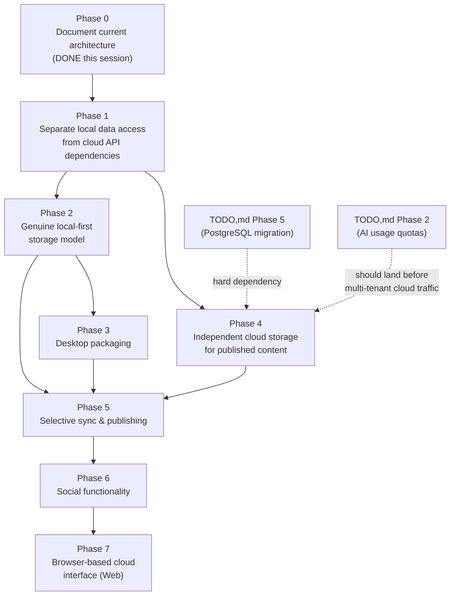

# PhotoLib — Migration Plan

> **Status: FUTURE / PROPOSED.** This is a plan, not a changelog — none of
> the phases below have started. It describes how to get from today's
> codebase (`PROJECT-ANALYSIS.md`) to the target architecture
> (`ARCHITECTURE-PROPOSED.md`) without breaking what currently works or
> losing user data along the way.

---

## 0. How to read this document

Each phase lists:
- **Goal** — what becomes true once the phase is done.
- **Required changes** — concretely, what gets built or modified.
- **Dependencies** — which earlier phases (or existing `TODO,md` items)
  must already be done.
- **Risks** — what could go wrong, and how serious.
- **Data migration** — whether existing users' data needs a transformation,
  and what happens to it if the phase is abandoned partway.
- **Acceptance criteria** — how to know the phase is actually complete,
  not just "mostly working."

Phases are **sequential by dependency, not by calendar** — a phase can sit
unstarted indefinitely without blocking the current app from working;
nothing here is on a deadline, and the current single-backend app keeps
working throughout every phase until Phase 6 deliberately changes its
behavior.

**Relationship to existing `TODO,md` phases**: `TODO,md`'s SaaS/
Monetization section already has its own Phase 1 (auth — **done**, see
`PROJECT-ANALYSIS.md`), Phase 2 (AI quotas), Phase 3 (billing), Phase 4
(security hardening), Phase 5 (PostgreSQL + monitoring). Those are
orthogonal to most of this plan except where explicitly cross-referenced
below — e.g. this plan's Phase 5 (cloud storage) has a hard dependency on
`TODO,md`'s Phase 5 (PostgreSQL), not because cloud storage needs billing,
but because SQLite's single-writer model (already flagged as a known
limitation) cannot safely serve a real multi-tenant cloud database.

---

## Phase 0 — Document current architecture *(done)*

**Goal**: an accurate, code-verified description of what exists today, so
every later phase has a trustworthy baseline instead of working from
assumptions or stale docs.

**Status**: complete as of this session. `PROJECT-ANALYSIS.md` rewritten
from direct code inspection; `README.md` and `TODO,md` reconciled;
`ARCHITECTURE-PROPOSED.md` and this document added.

**Acceptance criteria**: ✅ met — `PROJECT-ANALYSIS.md` distinguishes
implemented vs. planned functionality throughout, verified against actual
files rather than prior documentation.

---

## Phase 1 — Separate local data access from cloud API dependencies

**Goal**: the frontend's data-access layer has one clean seam between
"talks to a backend over HTTP" and "everything else," so a later phase can
swap *which* backend (local vs. cloud) without touching UI components.

**Required changes**:
- Audit confirms this is **mostly already true** (`PROJECT-ANALYSIS.md`
  §11) — every network call funnels through `ApiService`. The gap is
  narrower than a full refactor: formalize it as an explicit, documented
  contract (an interface or equivalent convention) rather than an
  accidental property, so it doesn't silently erode as new features are
  added (the way a new feature *could* reach for `HttpClient` directly if
  no one's enforcing the convention).
- Introduce a lightweight **data-source selection point** (e.g. a single
  injected base-URL/config token) so "local backend at `localhost:{port}`"
  vs. "cloud backend at `api.photolib.example`" is a configuration
  difference, not a code difference, in every service under `services/`.
- No change needed to `core/offline/` — its "the backend might be
  unreachable" assumption already fits a local-first world unchanged.

**Dependencies**: none (can start immediately).

**Risks**: low. This is mostly a discipline/documentation exercise given
how clean the existing boundary already is — the main risk is scope creep
into "let's also refactor X while we're in here," which should be resisted
to keep this phase low-risk and fast.

**Data migration**: none — no schema or stored-data changes.

**Acceptance criteria**:
- A documented rule (e.g. a lint rule or code-review checklist item) that
  no component/feature service injects `HttpClient` directly.
- The base API URL is read from one injectable config point, not
  hardcoded as `/api/...` relative paths scattered through service files.
- Existing app behavior is 100% unchanged — this phase is invisible to
  users.

---

## Phase 2 — Introduce a genuine local-first storage model

**Goal**: the *backend itself* can run fully standalone, pointed at a
local SQLite file and local photo folder, with no cloud account, no
Tailscale/network assumption, and no cookie-auth requirement for a
single-user local install.

**Required changes**:
- A **local-mode configuration profile** for the existing ASP.NET Core
  backend: `Storage:PhotosPath`/`Storage:AvatarsPath` pointed at a
  user-chosen local folder (not a Docker volume path), SQLite connection
  string pointed at a local file (e.g. inside the OS's standard app-data
  directory), bound to `127.0.0.1` only.
- A **local-mode auth bypass**: single-user local installs shouldn't
  require sign-in/cookie sessions at all (per `ARCHITECTURE-PROPOSED.md`
  §2.A's "no authentication required"). This needs a deliberate decision
  about how `[Authorize]`/`GalleryAccessService`'s ownership model behaves
  with no signed-in user — likely a synthetic "local owner" identity
  created on first run, so the existing ownership-scoped query shape
  doesn't need to fork into two code paths.
- Decide the **local database's relationship to a later-connected cloud
  account**: when a user eventually signs in from a previously
  account-less local install, what happens to the galleries already
  created under the synthetic local-owner identity? (Proposed: they become
  that cloud account's local-only content, `OwnerId` reassigned — directly
  analogous to today's existing "first admin account claims legacy
  ownerless galleries" mechanism in `AuthController.AdminRegister`, which
  is a close precedent for exactly this kind of one-time ownership
  migration.)

**Dependencies**: Phase 1 (so the frontend doesn't care which backend mode
it's talking to).

**Risks**: **medium**. The local-owner-identity decision affects every
`[Authorize]`-gated endpoint's behavior and needs careful review — getting
it wrong risks either breaking ownership isolation (if "local mode" leaks
into shared-instance deployments) or breaking the existing shared-instance
Tailscale deployment model (if the auth bypass isn't cleanly scoped to
local mode only). Mitigate by making local-mode an explicit, separate
build/launch configuration, not a runtime toggle on the same deployed
instance that also serves shared Tailscale users.

**Data migration**: none yet — this phase introduces a *new* way to run
the backend; it does not migrate any existing shared-instance data.

**Acceptance criteria**:
- The existing backend, unmodified in its Docker/shared-instance mode,
  continues to work exactly as today.
- A new local-mode launch path starts the backend with no auth required,
  against a local SQLite file, and the existing Angular frontend (pointed
  at it per Phase 1) works fully — create/upload/organize/browse/tag,
  offline-tolerant exactly as it already is, since "offline" and "no
  cloud account" become nearly the same state in local mode.

---

## Phase 3 — Desktop packaging

**Goal**: an installable desktop application wrapping Phase 2's local-mode
backend + the existing Angular frontend, per the recommendation in
`ARCHITECTURE-PROPOSED.md` §5.2 (Tauri shell + locally-run ASP.NET Core
backend + existing Angular UI in a WebView).

**Required changes**:
- A minimal Tauri project: process-lifecycle management (start the local
  backend as a child process on launch, stop it cleanly on quit — ASP.NET
  Core needs a graceful-shutdown signal handled, not a hard kill, so
  in-flight SQLite writes aren't interrupted), a window pointed at the
  local backend's `localhost` URL, a system-tray/launcher icon.
- Platform-specific installers (Windows MSI/NSIS, macOS `.dmg`, Linux
  AppImage/`.deb` — Tauri's bundler handles the mechanics; what's new here
  is validating the ASP.NET Core runtime's distribution story per platform,
  specifically whether to bundle a self-contained .NET runtime per install
  or depend on a shared one — self-contained is the safer default for an
  end-user-facing installer, at a larger download-size cost).
- A **file/folder picker** for choosing where the local library lives
  (first-run setup), using Tauri's own filesystem dialog APIs rather than
  anything browser-sandboxed.
- An **auto-update mechanism** (Tauri's built-in updater plugin) — not
  optional for a real desktop product; users will not manually reinstall.

**Dependencies**: Phase 2 (a working local-mode backend to wrap).

**Risks**: **medium-high**, concentrated in territory not yet validated by
any part of the current codebase: whether the existing Angular build's
routing/base-href assumptions behave correctly inside a Tauri WebView
pointed at `localhost` (flagged, not yet confirmed, in
`PROJECT-ANALYSIS.md` §11); cross-platform ASP.NET Core child-process
lifecycle edge cases (zombie processes if the Tauri shell crashes without
cleanly stopping its child); code-signing/notarization requirements per
platform (macOS Gatekeeper, Windows SmartScreen) which are process/cost
concerns, not just engineering ones.

**Data migration**: none — first-run setup creates a fresh local database;
nothing to migrate from in a pure-desktop-first install.

**Acceptance criteria**:
- A signed, installable package exists for at least one platform (pick the
  team's primary dev platform first; cross-platform validation can follow)
  that installs, launches, creates a local library on first run, and
  supports the full existing feature set (minus anything that was already
  server-shared-instance-specific, like the bookmarklet's relay page,
  which needs its own local-mode review, not assumed to port unchanged).
- Quitting the app cleanly stops the local backend process (verified via
  OS process inspection, not just "the window closed").
- Works with the network disconnected, from first launch — no feature
  degrades.

---

## Phase 4 — Establish independent cloud storage for published content

**Goal**: a real, separately-deployed cloud backend exists, with its own
multi-tenant database and blob/object storage, able to durably hold
published content independent of any desktop install being online —
per `ARCHITECTURE-PROPOSED.md` §1/§3.

**Required changes**:
- **Hard prerequisite**: migrate off SQLite to PostgreSQL for this cloud
  deployment specifically (`TODO,md`'s existing Phase 5 item) — SQLite's
  single-writer model, already flagged as a known limitation, is
  disqualifying for a real multi-tenant cloud database, not just a
  someday-nicety.
- A new cloud-specific data model: accounts, published-content index,
  derivative-tier metadata (§5 of `ARCHITECTURE-PROPOSED.md`) — related to
  but **not identical** to the local `Gallery`/`Photo` schema (the cloud
  needs `Visibility`, publish timestamps, and derivative-generation status
  that pure local storage never needs).
- Object/blob storage integration (S3-compatible — AWS S3, Cloudflare R2,
  Backblaze B2, or self-hosted MinIO are all viable; pick based on cost/
  egress-fee tolerance, a product decision not resolved here) for
  originals + the 3 proposed derivative tiers.
- A **derivative-generation pipeline** — likely an async job (publish
  triggers thumbnail/medium/high-res generation server-side, not
  synchronously in the publish request) since generating 3 derivative
  tiers for a batch publish shouldn't block the user's UI.
- A new **cloud backup strategy**, independent of the existing Docker
  Compose `backup` service (which assumes one SQLite file + one uploads
  folder on one host — doesn't fit a managed PostgreSQL + object-storage
  deployment at all).

**Dependencies**: Phase 1 (clean API boundary). *Not* dependent on Phases
2–3 — cloud storage can be built and tested against the existing
Tailscale-shared-instance frontend before desktop packaging exists, since
"publish to cloud" is meaningful even from a browser-only client. Hard
external dependency on `TODO,md` Phase 5 (PostgreSQL).

**Risks**: **high** — this is the first phase introducing genuinely new
infrastructure (a second deployed service, a different database engine, a
third-party or self-hosted object store) rather than extending the
existing single backend. Cost risk (storage + egress fees) needs a
pricing/budget decision before real usage, not after. Operational risk
(a second service to monitor/back up/secure) is new surface area this
project has not previously carried.

**Data migration**: none of *existing users'* data needs migrating — this
phase stands up a new, empty cloud deployment. (The existing SQLite→
PostgreSQL migration, if also applied to any *shared-instance* deployment
rather than just this new cloud one, is `TODO,md` Phase 5's own concern
and has its own data-migration story, orthogonal to this plan.)

**Acceptance criteria**:
- A photo published from a test account is fetchable via the cloud API
  with the test account's originating device fully powered off/
  disconnected — the literal acceptance test for "published content
  survives the owner's device being off."
- All 4 derivative tiers (§5.1) are generated and served with correct
  content-negotiation (`Accept` header → WebP/AVIF/JPEG).
- The cloud backup strategy has been exercised at least once (a real
  restore-from-backup drill, not just "the backup job ran without error").

---

## Phase 5 — Implement selective synchronization and publishing

**Goal**: a Desktop (or any client) can connect to a cloud account and
explicitly publish/sync content, per the five distinct operations in
`ARCHITECTURE-PROPOSED.md` §3.2, without conflating them.

**Required changes**:
- Sign-in flow connecting a local Desktop install (or, if this phase lands
  before Phase 3, the existing web client) to a cloud account — the local
  database gains a nullable "connected cloud account id," not a
  requirement.
- **Publish** UI/flow: select a local gallery, choose a `Visibility` level,
  trigger upload of the original + await derivative generation (Phase 4),
  record the assigned cloud id back onto the local `Gallery`/`Photo`
  records (§3.3's "cloud assigns the id, never the device").
- **Private cross-device sync** flow: extend (not replace) the existing
  `SyncCoordinatorService`/outbox shape to target "my cloud account" as
  the sync peer instead of "the one shared backend" — the existing
  conflict-detection logic (`updatedAtUtc` comparison) is directly
  reusable per `ARCHITECTURE-PROPOSED.md` §6.2.
- **Resumable/chunked upload** for large originals (§6.3 of the
  architecture doc) — a genuinely new capability, not a tuning change to
  the existing 3-retry logic.
- Structural prevention of domains 3/4 (another user's content, saved
  references) ever entering the mutation outbox — a read-only reference
  table instead (§6.1).

**Dependencies**: Phase 2 (local-first storage model — publishing *from*
something requires that something to exist independently first), Phase 4
(somewhere to publish *to*). Does not strictly require Phase 3 (desktop
packaging) — publishing could be validated from the existing web client
against local-mode-Phase-2 data first, though the full product vision
assumes Desktop exists by this point.

**Risks**: **high** — this phase is where the four-domain distinction
(§6.1 of the architecture doc) either holds up under real implementation
pressure or doesn't; the biggest risk is schedule pressure leading to
"just reuse the existing outbox for everything," which would silently
reintroduce the single-domain conflation this whole plan exists to avoid.
Concurrent-edit conflict UX (two devices, same cloud-synced photo, a
genuine conflict) needs real user testing, not just the existing
single-backend sync-review modal assumed to generalize unchanged.

**Data migration**: existing shared-Tailscale-instance users' data is
**not automatically migrated to cloud accounts** — that deployment model
continues to exist independently (see §"What doesn't change" below) unless
a specific user chooses to connect and publish from it.

**Acceptance criteria**:
- A gallery published from device A is visible (per its visibility level)
  via the cloud API with device A offline.
- The same cloud account, connected from device B, can selectively sync
  down the published gallery without having to re-publish it.
- A genuine edit conflict (same cloud-synced photo edited on A and B while
  both briefly offline from each other) surfaces as an explicit review
  item, not a silent last-write-wins overwrite.
- Revoking a share (§3.4) stops new access within a defined, tested time
  bound (e.g. next request, not next cache-expiry-whenever).

---

## Phase 6 — Implement social functionality

**Goal**: friends/following, cross-user feeds, saving others' photos — the
"Social" half of `ARCHITECTURE-PROPOSED.md` §2.B.

**Required changes**:
- `Follow`/`Friendship` data model (direction matters — "following" is
  typically one-directional with an optional "friends" = mutual-follow
  convention, a product decision to make explicitly, not default into).
- Extend `DiscoveryFeedService`'s existing tag-affinity weighting
  (`PhotoView`-based, already live and single-user today — direct reuse,
  not a rewrite) to include friends'/followed-public content in its
  candidate pool, respecting visibility per request.
- "Save to my feed" flow implementing §3.5's reference-with-attribution
  model, including the tombstone-on-revocation behavior.
- Per-request permission checks on every cross-user read path — this is
  where `GalleryAccessService`'s existing "ownership check, 404 if not
  owned" pattern needs a genuine extension (not replacement) to "ownership
  OR granted-visibility check."

**Dependencies**: Phase 5 (publishing/visibility must exist before
"friends can see published content" is meaningful).

**Risks**: **high** — this is the phase most exposed to real-world misuse
concerns (harassment via unwanted follows, content scraping of public
feeds, revocation not propagating fast enough to matter) that have no
precedent in the current single-tenant-per-instance, Tailscale-only app.
Needs explicit product/moderation-policy decisions this document doesn't
make (report/block mechanisms, rate limits on public-feed scraping) before
launch, not just the engineering described here.

**Data migration**: none for existing users beyond what Phase 5 already
introduced (a nullable cloud-account link) — following/friend graphs start
empty for everyone.

**Acceptance criteria**:
- Two test cloud accounts can follow each other, and User B's Discovery
  feed includes User A's public photos with correct attribution.
- A save-to-feed action by B, followed by A deleting the original, results
  in B's reference becoming a visible tombstone (not a silent broken
  image, not a continued-serving stale copy) — unless A's grant included
  download-original, in which case B's independent copy is unaffected, and
  this distinction is verified, not assumed.
- Revoking A's public visibility stops it appearing in B's feed on B's
  next load.

---

## Phase 7 — Introduce the browser-based cloud interface (Web)

**Goal**: `ARCHITECTURE-PROPOSED.md` §2.C — a browser client of the cloud
API, independent of any desktop install.

**Required changes**:
- Likely the **least net-new frontend work** of any phase: the existing
  Angular app, already built against the Phase-1 clean API boundary, is a
  strong starting point — the open question is whether Web should be
  *the same Angular codebase* pointed at the cloud API (reusing local-
  library-specific UI it doesn't need, like local-folder pickers) or a
  trimmed build. Recommend starting with the same codebase pointed at the
  cloud API and *removing* desktop-only affordances behind a build flag,
  rather than forking a second frontend project — directly consistent
  with this plan's Phase-1 "one clean seam" investment paying off here.
- A logged-out public-browsing mode (profiles, public feeds/collections)
  — new, since today's `LoginComponent` is a full-screen, non-dismissible
  gate with no logged-out browsing path at all (confirmed in
  `PROJECT-ANALYSIS.md` §6).
- Server-side rendering or at least solid meta-tag/Open-Graph support for
  public profile/collection pages, if discoverability/link-sharing matters
  for the social product — a product decision affecting scope here,
  flagged rather than resolved.

**Dependencies**: Phase 6 (social functionality should exist before a
public-facing web surface for it is built, or Web ships with Discovery/
feeds but no follow/friend UI yet as a smaller first cut — a legitimate
scope-reduction option, not a hard blocker either way).

**Risks**: **medium** — technically the most straightforward phase given
Phase 1's groundwork, but carries the most *public-facing* exposure
(performance under real anonymous traffic, SEO/crawlability if public
content is meant to be discoverable externally, abuse-resistance for a
logged-out-accessible surface) of any phase so far.

**Data migration**: none.

**Acceptance criteria**:
- A logged-out visitor can browse a public profile/collection with zero
  PhotoLib installation, via a shared link.
- A signed-in Web user has full parity with Desktop for everything that
  isn't inherently local (following, publishing-status viewing, feed
  browsing) — explicitly *not* parity for local-file-folder management,
  which doesn't apply to a browser client.

---

## What doesn't change, throughout

Explicitly, to set expectations for anyone reading this plan mid-execution:

- The existing Docker Compose / Tailscale-shared-instance deployment model
  (today's actual production use) **keeps working, unmodified, through
  every phase above**, unless/until a specific future decision is made to
  sunset it in favor of "everyone runs Desktop + an optional cloud
  account" instead. This plan does not assume that decision — it's a
  genuinely open product question, not an engineering one.
- No phase requires deleting or migrating existing shared-instance users'
  galleries/photos against their will.
- `TODO,md`'s existing SaaS/Monetization phases continue independently —
  they intersect with this plan (shared PostgreSQL dependency, shared
  "real user accounts" foundation that's already done) but are not
  subsumed by it; billing a shared Tailscale instance's AI feature and
  running a social cloud platform are different products that happen to
  share some infrastructure.
