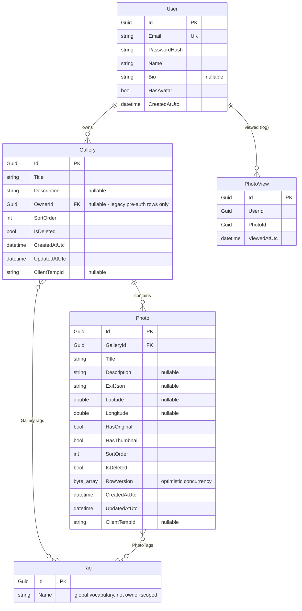
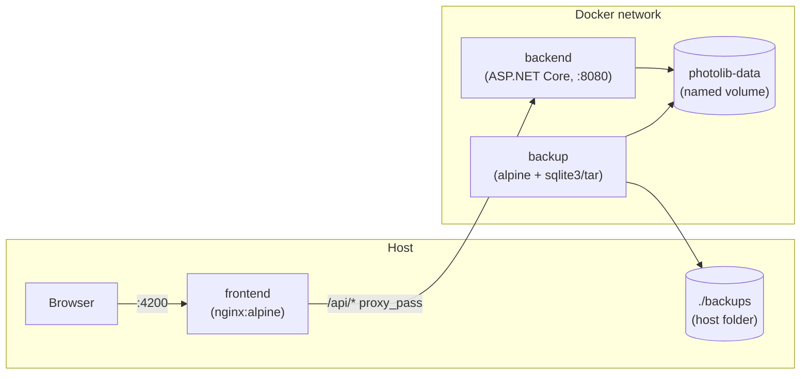

# PhotoLib — Current-State Technical Analysis

Date: 2026-11-14 (full re-audit, direct code inspection — not a docs review).
Location: `H:/Programming/Angular/photolib-ng-v3`
Git: branch `main`, in sync with `origin/main`, working tree clean (only
`.claude/` and this file itself untracked — no uncommitted application code).

This document describes **what is actually implemented today**, verified by
reading the code, not by trusting prior documentation. Section 13 separately
covers the proposed future direction's relationship to this baseline — see
`ARCHITECTURE-PROPOSED.md` and `MIGRATION-PLAN.md` for the forward-looking
material; this file stays descriptive of the present system.

---

## 1. Product overview

PhotoLib is a self-hosted, offline-first photo library for a small group of
people (a household or a few friends) sharing one instance over a private
network (Tailscale), each with their own account and private library.
Frontend in Angular 19, backend in ASP.NET Core 9, SQLite storage, Docker
Compose deployment. No public internet exposure is assumed anywhere in the
design — authentication exists to separate users on a *shared* instance, not
to gate access from the open internet.

Core loop: create galleries, upload photos (EXIF/GPS parsed automatically),
tag and organize them, browse offline when the server is unreachable, and
optionally draft photo descriptions with Claude. A newer **Discovery**
feed surfaces a live, tag-weighted shuffle of the user's own photos across
all their galleries, independent of which gallery is currently open.

---

## 2. Technology stack

**Frontend**
- Angular 19.2, standalone components (no NgModules), zone.js-based change
  detection (`provideZoneChangeDetection({ eventCoalescing: true })`)
- Angular CDK 19.2 — drag-and-drop (galleries, photo grid) and virtual
  scrolling (gallery feed view)
- `@angular/animations` 19.2 (added this session) — `provideAnimations()`
- RxJS 7.8
- IndexedDB via the `idb` package — offline mirror, outbox, image blob cache
- Own i18n (BE/EN, ~250 keys in one flat dictionary) and theme system
  (3 dark presets via CSS custom properties) — no third-party libraries for
  either
- TypeScript 5.7, built via the Angular `application` builder (Vite-based
  dev server, esbuild production bundling) — no SSR

**Backend**
- ASP.NET Core 9 Web API (net9.0), nullable + implicit usings enabled
- Entity Framework Core 9 + SQLite (same engine in dev and Docker — no
  separate prod database)
- `MetadataExtractor` 2.8.1 — EXIF/GPS reading
- `SixLabors.ImageSharp` 3.1.12 — thumbnail/avatar resizing, re-encodes
  everything to JPEG server-side
- `Anthropic` .NET SDK 12.35.1 — optional AI photo-description feature
- `Microsoft.AspNetCore.RateLimiting` — five named fixed-window policies
- `Swashbuckle.AspNetCore` 6.5.0 — Swagger, Development-environment only
- Cookie-based auth (`Microsoft.AspNetCore.Authentication.Cookies`),
  `IPasswordHasher<User>` (framework-provided `PasswordHasher<User>`, no
  ASP.NET Core Identity)

**Infrastructure**
- Docker Compose: `backend` (ASP.NET Core, port 8080 internally), `frontend`
  (nginx serving the Angular build + reverse-proxying `/api/*`, published on
  host port 4200), `backup` (Alpine + sqlite3/tar/gzip, polling loop)
- One named volume `photolib-data` holds the SQLite file and
  `uploads/{photos,avatars}`
- Access for other people: Tailscale VPN mesh, not public exposure

---

## 3. Component architecture

### Backend — `backend/`

No CQRS/MediatR; plain controllers + EF Core, appropriately simple for the
project's size.

**Controllers** (`backend/Controllers/`, 7 total):

| Controller | Scope |
|---|---|
| `AuthController` | login/register/logout/session/profile, admin-key-gated first-account creation |
| `AvatarController` | upload/fetch the signed-in user's avatar (split out of `AuthController` for SRP) |
| `GalleryController` | gallery CRUD, tags, reorder |
| `PhotoController` | photo CRUD, file/thumbnail serving, upload, move/copy, tags, reorder, AI description, view-tracking, the unauthenticated bookmarklet endpoint |
| `TagController` | global tag list (autocomplete) |
| `DiscoveryController` | the weighted-random Discovery feed |
| `HealthController` | liveness probe, used by the frontend's `ConnectivityService` |

**Services** (`backend/Services/`, 12 classes + 1 exception type):

| Service | Responsibility |
|---|---|
| `CurrentUserService` | resolves the signed-in user's id from claims |
| `GalleryAccessService` | centralized ownership checks (`IsOwnedAsync`, `GetOwnedPhotoAsync`, `GetOwnedGalleryAsync`, `OwnedPhotos` query) — every 404-vs-403 decision flows through here |
| `TagResolver` | case-insensitive tag name → `Tag` entity resolution (loads the whole table into memory; SQLite's `LOWER()` is ASCII-only) |
| `PhotoFilePathHelper` / `AvatarFilePathHelper` | file-system path resolution for photo originals/thumbnails and avatars respectively |
| `PhotoImageProcessingService` | saves uploaded/downloaded bytes to disk (streamed, size-capped), generates a 300×300-max thumbnail + EXIF via ImageSharp |
| `AvatarImageProcessingService` | resizes an avatar to a fixed 256×256 center-crop square (one file, no original/thumbnail pair) |
| `ExifReader` | static helper, `MetadataExtractor`-based EXIF/GPS extraction, never throws |
| `SortOrderHelper` | shared "ordered id list → dense `SortOrder` values" logic for both galleries and photos |
| `UserResponseMapper` | shapes `User` → public response (excludes `PasswordHash`) |
| `PhotoDescriptionAiService` | Claude-backed draft title/description/tags, web-search-grounded |
| `DiscoveryFeedService` | Efraimidis–Spirakis weighted-random photo sampling, tag-affinity boost from `PhotoView` history |
| `AiFeatureDisabledException` | thrown when `Ai:Enabled` is false, mapped to 503 |

### Frontend — `frontend/src/app/`

```
core/
  api/            ApiService — thin HttpClient wrapper, flips ConnectivityService
                   offline on any status-0 response
  auth/           AuthService, authInterceptor (401 → sign-out), auth-error util
  offline/        LocalDbService (IndexedDB), outbox.model, SyncCoordinatorService,
                   ConnectivityService (health-probe based), ImageCacheService,
                   connectivity-error util (attemptOnline/isConnectivityError)
  i18n/           I18nService, TranslatePipe, translations.ts (~250 keys), plurals.ts
  theme/          ThemeService — 3 presets via [data-theme] + CSS custom properties
components/       login, toolbar, gallery-page, gallery-view (grid + feed),
                   photo-viewer (+ slideshow-player.service.ts, photo-actions,
                   photo-carousel), discovery (discovery-feed.component),
                   create-gallery, gallery-properties, gallery-select-modal
services/         PhotoApiService / GalleryApiService (offline-aware),
                   DiscoveryApiService / TagApiService (online-only, no mirror),
                   photo-selection, view-mode, thumbnail-size,
                   photo-metadata-editing, photo-upload
shared/           modals (edit-metadata, settings, slideshow-settings,
                   sync-review, add-from-internet, confirm, avatar-crop),
                   context-menu, photo-thumbnail, animations/
                   (reveal-top-down, fade-through), utils/modal-state
```

Standalone components throughout; no NgModules anywhere in the app.

---

## 4. Database schema and relationships

SQLite via EF Core, 13 migrations (`InitialCreate` → `AddPhotoViews`).



Notes confirmed by reading `PhotoDbContext.cs` and the model classes
directly:

- `Photo` has **no `OwnerId` of its own** — ownership is always resolved
  transitively through `Gallery.OwnerId`, centralized in
  `GalleryAccessService`.
- `Photo`↔`Tag` and `Gallery`↔`Tag` are **unidirectional many-to-many**
  (`PhotoTags`/`GalleryTags` shadow join tables) — `Tag` has no navigation
  back to either, specifically to keep tag reads free of serialization
  cycles.
- `PhotoView` has **no navigation properties at all** (same pattern as
  `Tag`) — it's written and read only in aggregate, never serialized
  per-row. Indexed on `UserId` only (the one column its weighting query
  filters by).
- `Gallery.OwnerId` is `Guid?` specifically because SQLite/EF Core can't add
  a `NOT NULL` FK against existing rows in one migration step — every
  gallery created since auth was introduced always has a real owner in
  application code.
- Explicit indexes: `Photo.Id`, `Photo.GalleryId`, `(Photo.Id,
  Photo.ClientTempId)` composite, `Gallery.OwnerId`, unique `User.Email`,
  `PhotoView.UserId`.

**Migration timeline** (chronological):
`InitialCreate` → `AddHasOriginalToPhoto` → `AddHasThumbnailToPhoto` →
`RemoveBlobAndThumbnailUrlscls` (dropped an earlier blob-in-DB design) →
`AddSoftDeleteToGallery` → `AddDescriptionToGallery` → `AddTags` →
`AddPhotoGps` → `AddSortOrder` → `AddGalleryClientTempId` → `AddUsers` →
`ChangeGalleryOwnerIdToGuid` → `AddUserProfile` (Name/Bio/HasAvatar) →
`AddPhotoViews`. The early blob-storage reversal is worth noting as a sign
the file-on-disk design was a deliberate correction, not the original plan.

---

## 5. API structure

All routes under `/api/`. `[Authorize]` is the class-level default on every
controller except `HealthController`; exceptions are called out.

| Method | Route | Auth | Notes |
|---|---|---|---|
| POST | `Auth/login` | anonymous | rate-limited (`AuthLogin`: 10/15min/IP) |
| POST | `Auth/register` | anonymous | self-service, rate-limited (`AuthRegister`: 5/hr/IP) |
| POST | `Auth/change-password` | required | rate-limited (`AuthChangePassword`: 10/15min/IP) |
| POST | `Auth/logout` | anonymous | |
| GET | `Auth/me` | required | |
| PUT | `Auth/me` | required | update own Name/Bio |
| POST | `Auth/admin/register` | `X-Admin-Key` header | rate-limited (`AuthAdminRegister`: 5/hr/IP); first-ever account claims legacy `OwnerId == null` galleries |
| POST | `Avatar/me` | required | upload/replace own avatar |
| GET | `Avatar/me` | required | |
| GET | `Gallery` | required | |
| GET | `Gallery/dev`, `Gallery/dev/deleted` | required | dev-only inspection endpoints |
| GET | `Gallery/{id}` | required | |
| POST | `Gallery` | required | |
| PUT | `Gallery/{id}` | required | |
| PUT | `Gallery/{id}/tags` | required | |
| PUT | `Gallery/reorder` | required | |
| DELETE | `Gallery/{id}` | required | soft delete |
| DELETE | `Gallery/admin/{id}` | required | hard delete, dev cleanup |
| GET | `Photo/by-gallery/{galleryId}` | required | |
| GET | `Photo/dev/by-gallery/{id}`, `Photo/dev/deleted/by-gallery/{id}` | required | dev-only |
| GET | `Photo/{id}` | required | metadata only |
| GET | `Photo/{id}/file`, `Photo/{id}/thumbnail` | required | binary image responses |
| POST | `Photo` | required | create metadata record |
| POST | `Photo/{id}/upload` | required | attach the file |
| GET | `Photo/capture` | anonymous | bookmarklet relay page |
| POST | `Photo/from-url` | **anonymous**, `AllowAnyOrigin` CORS | bookmarklet capability-token endpoint, documented trade-off |
| PUT | `Photo/{id}` | required | |
| POST | `Photo/{id}/generate-description` | required | rate-limited (`AiGeneration`: 10/hr/IP), 503 if `Ai:Enabled=false` |
| POST | `Photo/{id}/view` | required | records a `PhotoView` row (feeds Discovery) |
| PUT | `Photo/{id}/tags` | required | |
| POST | `Photo/{id}/move`, `Photo/{id}/copy` | required | |
| DELETE | `Photo/{id}` | required | soft delete |
| PUT | `Photo/reorder` | required | |
| DELETE | `Photo/admin/{id}` | required | hard delete, dev cleanup |
| GET | `Tag` | required | global vocabulary, not owner-scoped |
| GET | `Discovery/feed` | required | `count`/`exclude` query params, live-sampled every call |
| GET | `Health` | anonymous | |

No pagination exists anywhere in the API — every list endpoint returns the
full result set. Fine at current scale; would need revisiting for a
multi-tenant cloud with large libraries.

---

## 6. Authentication and authorization

- **Session**: `HttpOnly` cookie, `SameSite=Lax`, 30-day sliding expiration.
  `CookieAuthenticationHandler`'s default redirect-to-login-page behavior is
  overridden (`OnRedirectToLogin`/`OnRedirectToAccessDenied`) to return bare
  `401`/`403` — this is an API-only backend with no server-rendered login
  page.
- **Password hashing**: `IPasswordHasher<User>` → `PasswordHasher<User>`
  (ships in the ASP.NET Core shared framework), injected via DI rather than
  constructed ad hoc.
- **Account creation**: two paths — open `POST /Auth/register` (safe because
  reachability is gated by the Tailscale network, not the endpoint itself),
  and `X-Admin-Key`-gated `POST /Auth/admin/register` reserved for the
  instance owner's first account, compared via
  `CryptographicOperations.FixedTimeEquals` (timing-attack resistant).
- **Ownership model**: every ownership check returns `404`, never `403` — a
  guessed/enumerated id belonging to another user is indistinguishable from
  one that doesn't exist. Centralized in `GalleryAccessService`.
- **Rate limiting**: five named fixed-window policies, all keyed by
  `RemoteIpAddress` (not per-user) — `AiGeneration` (10/hr), `AuthLogin`
  (10/15min), `AuthAdminRegister` (5/hr), `AuthRegister` (5/hr),
  `AuthChangePassword` (10/15min).
- **CORS**: locked down by default; one explicit `AllowAnyOrigin` policy
  (`BookmarkletUpload`) scoped only to the `from-url` bookmarklet endpoint,
  plus a manual middleware shim for Chrome's Private Network Access preflight
  header (ASP.NET Core's CORS middleware doesn't set it yet).
- **Frontend**: full-screen, non-dismissible `LoginComponent` gates the
  whole app; a functional `authInterceptor` reacts to any `401` by clearing
  `AuthService.currentUser`; `provideAppInitializer` blocks first render
  until the session check resolves (no flash of the gallery UI pre-login).
- **No password reset / account recovery** exists at all — losing a
  password means starting over with a new account. Explicitly documented in
  `FRIENDS-ACCESS-GUIDE.md`.

---

## 7. File storage and image processing

Photo/gallery metadata lives in SQLite; **image bytes never enter the
database** (an earlier design did store blobs — reversed by the
`RemoveBlobAndThumbnailUrlscls` migration).

```
uploads/
  photos/
    originals/{photoId}.jpg
    thumbnails/{photoId}.jpg
  avatars/
    {userId}.jpg
```

- **Originals**: saved via `PhotoImageProcessingService.SaveStreamToFileAsync`
  — streamed in 80 KB chunks with a hard byte cap (aborts and deletes the
  partial file if exceeded, so a large/malicious response can't balloon
  server memory before being rejected). Always re-encoded/saved as `.jpg`
  regardless of the source format.
- **Thumbnails**: `GenerateThumbnailAndExif` resizes to **300×300 max**
  (`ResizeMode.Max`, aspect-preserving) via ImageSharp, saved alongside the
  original. Upload order was recently hardened (this session): the original
  is persisted and `HasOriginal=true` is saved to the DB *before* thumbnail
  generation is attempted, and the exception caught was widened from
  `UnknownImageFormatException` to `ImageFormatException` — so a corrupt or
  exotic JPEG that fails to decode for thumbnailing no longer orphans the
  original file or blocks the upload; it just leaves `HasThumbnail=false`.
- **Avatars**: single 256×256 center-crop square
  (`AvatarImageProcessingService`, `ResizeMode.Crop`) — no
  original/thumbnail distinction, one file replaces the previous one.
- **EXIF/GPS**: `ExifReader` (static, `MetadataExtractor`-based) — never
  throws, returns an empty result for formats without EXIF (e.g. PNG). GPS
  coordinates extracted via `GpsDirectory.GetGeoLocation()` when present.
  Stored as a JSON blob (`Photo.ExifJson`) of `{name, tags:[{name,
  description}]}` groups, plus flattened `Latitude`/`Longitude` columns for
  querying/map display.
- **Serving**: dedicated binary endpoints (`/Photo/{id}/file`,
  `/Photo/{id}/thumbnail`, `/Avatar/me`) rather than embedding URLs in JSON
  responses — all serve `ImageContentTypes.Jpeg` since everything is
  re-encoded to JPEG server-side. No WebP/AVIF, no responsive/multi-size
  derivatives beyond the one fixed thumbnail size.

---

## 8. Offline-first implementation

This is the most architecturally significant part of the current system —
verified by reading `LocalDbService`, `outbox.model.ts`,
`SyncCoordinatorService`, `ConnectivityService`, and `ImageCacheService` in
full.

### IndexedDB schema (`photolib-cache`, version 4, via the `idb` package)

| Store | Key | Purpose |
|---|---|---|
| `thumbnails` | `photoId` | blob cache, index on `cachedAt`, capped at 500 (LRU evict oldest-cached) |
| `originals` | `photoId` | blob cache, index on `viewedAt`, capped at **10** (LRU evict oldest-viewed) |
| `galleries` | gallery `id` | read mirror + `order` + `pendingOp`, index on `order` |
| `photos` | photo `id` | read mirror + `galleryId` + `order` + `pendingOp` + `localDeleted`, composite index `(galleryId, order)` |
| `outbox` | autoincrement `opId` | queued offline mutations, replayed in insertion order |

`navigator.storage.persist()` is requested (best-effort) specifically so a
disk-pressure eviction can't silently wipe unconfirmed outbox entries along
with the disposable image caches.

### Connectivity (`ConnectivityService`)

Backed by real `GET /api/Health` probes, not just `navigator.onLine` — the
latter is a fast first signal but doesn't reflect *this* backend being
specifically down. Re-probes every 15s while offline. The initial probe is
deferred to a microtask (fixed this session — a synchronous probe from the
constructor could trip Angular's circular-dependency guard when this
service happened to be the first thing constructed in a given change-
detection pass, since the HTTP call re-enters `authInterceptor` → `AuthService`
→ `ApiService` → back to this same service).

### Outbox (`outbox.model.ts`)

Eight mutation types: `create-gallery`, `create-photo`, `update`, `delete`,
`move`, `copy`, `setTags`, `reorder`. Each carries `baseUpdatedAtUtc`
(captured at queue time) used later for conflict detection. `update`/
`setTags`/`move` entries **coalesce** — queuing a new one of the same
type+entity replaces the previous not-yet-synced one rather than piling up
redundant rows (`LocalDbService.upsertOutboxEntry`); reorders coalesce per
scope the same way.

### Sync (`SyncCoordinatorService`)

- **Trigger**: `ConnectivityService.isOnline$` transitioning false→true
  (via `pairwise()` + `startWith(false)`, so a fresh page load that's
  already online still checks for a leftover outbox from a previous
  session).
- **Leader election**: Web Locks API (`navigator.locks.request` with
  `ifAvailable: true`) — only one tab actually replays; others just wait
  for a `BroadcastChannel('photolib-sync')` `'sync-completed'` message and
  refresh.
- **Reorders replay first and unprompted** (low-stakes, no data-loss risk);
  everything else builds a review list.
- **Conflict detection**: for each non-reorder outbox entry, fetches the
  entity's *current* live state (`updatedAtUtc`, `isDeleted`, `title`) and
  compares against the entry's captured `baseUpdatedAtUtc`. A mismatch, or
  the entity having been deleted server-side while a non-delete op was
  queued, or the entity being gone entirely (404), all surface as an
  explicit conflict in the sync-review modal rather than being silently
  overwritten or silently dropped.
- **Review → replay**: `confirmItem`/`discardItem` per entry (or presumably
  bulk, via the modal) drive `replayEntry`/local-mirror cleanup;
  `create-*` entries remap the client-generated id to the server-assigned
  one everywhere it's referenced (mirror rows, still-pending outbox
  entries, cached image blobs).
- Not yet audited in this pass: the exact bulk-confirm/discard UI wiring in
  `sync-review-modal.component.ts` itself (the coordinator's per-item API is
  confirmed; the modal's own batching logic wasn't re-read this session).

### Image cache (`ImageCacheService`)

Thin resolve-from-cache-or-fetch-and-cache layer over `LocalDbService`,
returning `URL.createObjectURL` object URLs the caller must revoke. Purely
lazy — nothing is pre-warmed. A WebKit-specific `Blob` rebuild-via-
`ArrayBuffer` workaround exists for a known Safari IndexedDB blob-storage
bug.

### What's online-only (no offline path)

`DiscoveryApiService` and `TagApiService` are plain `ApiService` wrappers
with **no** IndexedDB fallback — confirmed by reading both files, which
contain none of the `attemptOnline`/`LocalDbService` machinery
`PhotoApiService`/`GalleryApiService` use throughout. Discovery's live,
weighted-random nature makes a meaningful offline mirror impractical; it
shows a "needs a connection" placeholder instead
(`ConnectivityService.isOnline$ | async` gate in the template).

---

## 9. Deployment and backup

### Docker Compose (3 services, 1 named volume)



- `backend`: multi-stage Dockerfile (SDK build → aspnet runtime), reads
  `Storage__PhotosPath=/data/uploads/photos`,
  `Storage__AvatarsPath=/data/uploads/avatars`,
  `ConnectionStrings__DefaultConnection=Data Source=/data/photolib.db` —
  all under the single `photolib-data` volume mount at `/data`.
- `frontend`: multi-stage (`node:20-alpine` build → `nginx:alpine` serve),
  `nginx.conf` proxies `/api/` to `http://backend:8080/api/` and falls back
  every other route to `index.html` (SPA routing).
- `backup`: `alpine:3.20` + `sqlite3`/`gzip`/`tar`, entrypoint
  `backup.sh` — an infinite `while true` loop: `sqlite3 .backup` (the
  SQLite backup API, safe to run against a live, open database — not a
  risky raw file copy) → gzip, plus `tar -czf` of `uploads/`, both written
  to `/backups` (bind-mounted to `./backups` **on the host**, not just
  inside the named volume — survives volume corruption/deletion). Prunes to
  the `BACKUP_KEEP` most recent of each type (default 14) after every
  cycle; sleeps `BACKUP_INTERVAL_HOURS` (default 24) between runs. A failed
  cycle logs and retries next interval rather than crash-looping the
  container.
- **Migrations auto-apply on startup**: `Program.cs` calls
  `PhotoDbContext.Database.Migrate()` in a startup scope — no manual `dotnet
  ef database update` step for a fresh container.
- **Config/secrets**: dev uses `dotnet user-secrets` (`Anthropic:ApiKey`,
  `Auth:AdminKey`); Docker uses env vars via `.env`
  (`ANTHROPIC_API_KEY`→`Anthropic__ApiKey`, `AUTH_ADMIN_KEY`→`Auth__AdminKey`,
  `AI_ENABLED`→`Ai__Enabled`, `BACKUP_INTERVAL_HOURS`, `BACKUP_KEEP`) — the
  `appsettings.json`↔`docker-compose.yml` config-key names match correctly;
  no mismatch found.

### Dev vs prod

Identical database engine (SQLite) in both — there is no separate
production-grade database, by design for the current single-small-group
scale.

---

## 10. Internationalization and themes

- **i18n**: flat `Record<string, Record<'be'|'en', string>>` dictionary
  (~250 keys, one file, `translations.ts`), `I18nService` (plain mutable
  `lang` property + `localStorage` persistence, default `'be'`), impure
  `TranslatePipe` (re-evaluates every change-detection pass so a language
  switch is picked up everywhere immediately), `plurals.ts` for count-based
  phrasing. No per-user server-stored language preference — purely a
  client-side setting. Note: the newly-redesigned login screen (this
  session) is **hardcoded English**, deliberately bypassing this system as
  the portfolio-facing entry point — a known, called-out exception, not an
  oversight.
- **Themes**: `ThemeService`, 3 presets (`navy`/`charcoal`/`black`) via a
  `[data-theme]` attribute on `<html>` + CSS custom properties in
  `styles.css` — only the neutral canvas tokens move between presets; the
  brand ink/amber accent stays constant.

---

## 11. Extension points for desktop integration

**No deliberate desktop groundwork exists.** A targeted search
(`grep -rli "electron|tauri|ipc|showOpenFilePicker|showDirectoryPicker|
native"` across `frontend/src/`) found nothing beyond incidental matches on
Angular's own `.nativeElement` API — not related to desktop packaging in
any way. Any future desktop story starts from zero in that sense.

That said, one structural property works *in favor* of a future desktop
port, confirmed directly: every network call in the frontend funnels
through `core/api/api.service.ts`'s ~40-line `ApiService` wrapper
(`get/post/put/delete`, relative `/api/...` URLs). A repo-wide grep for
`HttpClient` injection outside `core/api/`/`core/offline/` turns up exactly
one hit — `app.config.ts`, where `provideHttpClient()` is registered. No
component or feature service injects `HttpClient` directly. This means the
seam between "talks to a remote backend over HTTP" and "the rest of the
app" is already clean, if accidentally so (not designed with desktop in
mind) — re-pointing calls at local IPC (Tauri) or a local embedded service
(Electron) is scoped to this one file plus `core/offline/` (which already
treats "the backend might be unreachable" as a first-class, handled state),
not a sweep through the whole component tree. See `ARCHITECTURE-PROPOSED.md`
§6 for the technology assessment this implies, and note it's a smaller
lift than "zero" might suggest — just not yet exercised in any real way.

---

## 12. Known limitations and technical debt

1. **SQLite under concurrent multi-user writes** — single-writer model, not
   built for several people writing simultaneously at real scale. Already
   recognized by the project's own `TODO,md` as the reason a future
   PostgreSQL migration is planned before any real multi-tenant load.
2. **No password reset.** Total account/library loss on a forgotten
   password for a friend-user. Documented in `FRIENDS-ACCESS-GUIDE.md`.
3. **AI endpoint has per-IP rate limiting only, no per-user quota.** A
   shared hosted instance has no real cost control beyond 10 requests/hour/IP
   and the global `Ai:Enabled` kill switch.
4. **`Gallery.OwnerId` is nullable** (`Guid?`) for historical migration
   reasons — deliberate, documented, but real schema debt if the data model
   is ever rebuilt from scratch.
5. **No mobile/touch layout at all.** Desktop-width-only throughout
   (toolbar, grid, viewer, every modal). HTML5 drag-and-drop (used for
   every reorder interaction) generally doesn't work on touch devices.
6. **`from-url` bookmarklet endpoint is unauthenticated with
   `AllowAnyOrigin` CORS** — a deliberate, documented capability-token
   trade-off, but worth flagging in any security review.
7. **No pagination anywhere in the API** — every list endpoint returns the
   full result set. Fine today; a real scaling concern for a cloud/social
   phase with large libraries or public feeds.
8. **Backup is local-only** — `./backups` lives on the same host/disk as
   the application; a disk failure takes both out. Already honestly
   documented in `README.md` with a recommendation to copy it off-site
   periodically.
9. **No image derivative strategy beyond one fixed-size thumbnail** — no
   WebP/AVIF, no responsive multi-size delivery, no separate "medium
   preview" tier between a 300px thumbnail and the full original. Relevant
   input for `ARCHITECTURE-PROPOSED.md` §5's proposed derivative pipeline.
10. **`frontend__broken/`** — if still present in the working tree, it's a
    stale/broken frontend copy with its own `node_modules` that should be
    removed for repo hygiene. (Not re-verified in this pass — flagged from
    the prior audit; confirm before relying on this.)
11. **Login screen is English-only**, bypassing the app's own i18n system —
    intentional for now (portfolio-facing entry point) but means the app is
    not actually fully bilingual end-to-end the way the rest of the UI is.

---

## 13. Uncommitted work and migration risk at time of audit

**None.** `git status` shows a clean working tree — every feature built
this session (Discovery feed, animations, login redesign, the
`ConnectivityService` circular-dependency fix) is committed and pushed to
`origin/main`. The only untracked items are `.claude/` (tooling, not
application code) and this analysis file itself.

This means any migration work proposed in `MIGRATION-PLAN.md` starts from a
known-good, fully-synced baseline — no risk of losing in-flight work during
the first phase.

---

## 14. Relationship to the proposed future architecture

This document describes the system **as it exists today**: a single-tenant-
per-instance, offline-first web application with no desktop packaging, no
cloud/social layer, and no public content model. The product direction
described in `ARCHITECTURE-PROPOSED.md` (Local-first Desktop + optional
Cloud/Social + Web) is **not implemented in any part of this codebase** —
there is no Electron/Tauri scaffold, no public-feed/friends/following data
model, no image-derivative/permission system beyond the one fixed
thumbnail, and no separation between "local data access" and "cloud API
dependency" in the frontend (today's `PhotoApiService`/`GalleryApiService`
assume exactly one backend, reached via relative `/api/...` URLs). See
`MIGRATION-PLAN.md` for how to get from this baseline to that target
without breaking what currently works.
